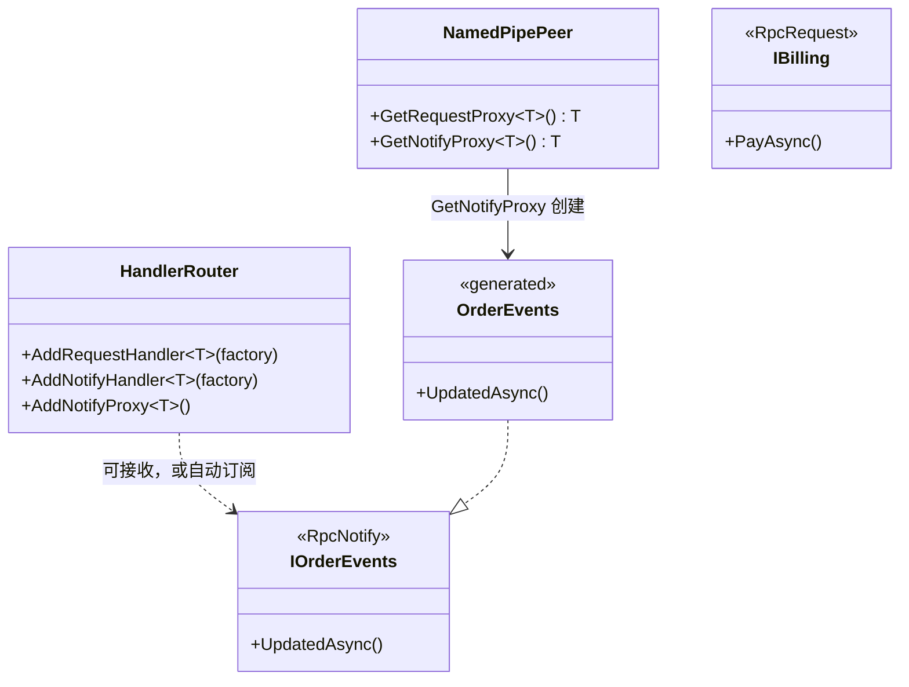

# Handler 与 Proxy

同一个接口可以同时出现在服务端和客户端。接口不表示本端角色。

- `AddNotifyHandler<T>(factory)` 登记本端可以接收的通知。方法进入目录，对方才能订阅成功。每条连接 `Start` 时创建一个实例。它不触发自动订阅。
- `AddNotifyProxy<T>()` 表示连接建立后自动订阅这些通知。
- `peer.GetNotifyProxy<T>()` 返回源生成器生成的代理对象，只向这一条连接发送。静态类型是契约接口。

请求侧对应的是 `AddRequestHandler<T>(factory)` 与 `peer.GetRequestProxy<T>()`。按方法名注册的 `AddNotifyHandler(string, ...)` 仍然会在连接后自动订阅，那条路径不经过上面的契约分工。

## 特性

| 特性 | 标在 | 作用 |
|------|------|------|
| `[RpcRequest]` | 接口或服务类 | 请求服务。`AddRequestHandler` 与 `peer.GetRequestProxy` |
| `[RpcNotify]` | 接口 | 通知通道。方法必须是非泛型 `Task` |
| `[RpcMethod]` | 方法 | 可选。覆盖管道上的 RPC 名或前缀 |

## 方法落在哪一层



| 方法 | 作用 |
|------|------|
| `AddNotifyHandler<T>(Func<NamedPipePeer, T> factory)` | 本端可以接收。每条连接一个实例。工厂不能返回生成的代理 |
| `AddNotifyProxy<T>()` | 连接后自动订阅。可在 `AddNotifyHandler` 之前或之后调用 |
| `NamedPipePeer.GetNotifyProxy<T>()` | 创建并缓存生成的代理，调用即 `Peer.Notify` |
| `NamedPipePeer.GetRequestProxy<T>()` | 创建并缓存生成的请求代理，调用即 `Peer.Request` |

## 用法

```csharp
[RpcNotify]
public interface IOrderEvents
{
    Task UpdatedAsync(string msg, CancellationToken ct = default);
}

// 服务端：可以接收，不自动订阅
serverRouter.AddNotifyHandler<IOrderEvents>(peer => new OrderEventsImpl(peer));

// 客户端：可以接收，并且连接后自动订阅
clientRouter.AddNotifyHandler<IOrderEvents>(peer => new OrderEventsSink(peer));
clientRouter.AddNotifyProxy<IOrderEvents>();

// 生成的代理只发给这一条连接
IOrderEvents outgoing = serverPeer.GetNotifyProxy<IOrderEvents>();
await outgoing.UpdatedAsync("hello");
```
