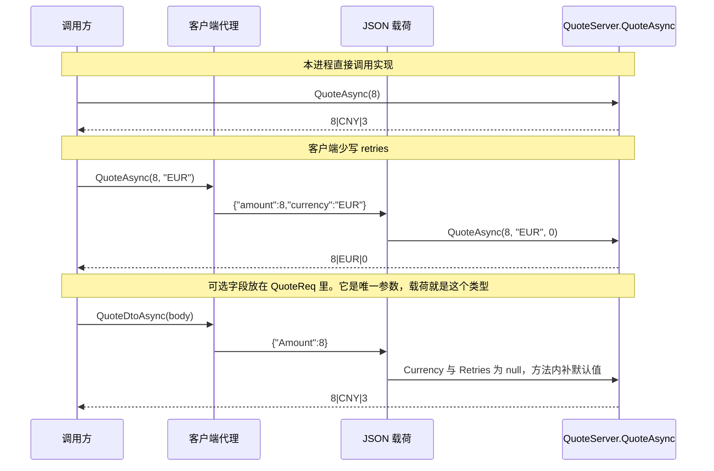
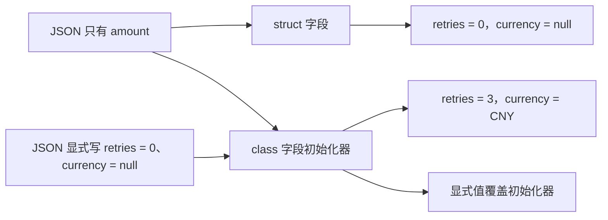

# 可选参数与参数个数不一致

两端不共享接口程序集。生成器只看本端方法，不读取另一端的参数列表，也不记录 C# 可选参数的默认值。管道上只对齐两件事：RPC 方法名，以及 JSON 形状。

`CancellationToken` 不进入载荷。下面的「参数个数」只计业务参数。

## 载荷形状

```mermaid
flowchart TD
    count["业务参数个数"] --> one["1 个：载荷就是该参数，不看参数名"]
    count --> many["2 个及以上：生成 Args struct"]
    many --> names["字段名必须一致"]
    names --> present{"字段都在？"}
    present -->|否| missing["缺少的字段使用类型默认值"]
    present -->|是| call["按字段调用处理方法"]
    missing --> call
    one --> dto["参数若是自定义类型，其内部成员可以缺"]
```

服务端注册走 `HandlerRouter.AddRequestHandler`，入站在 `NamedPipePeer.HandleIncomingReqAsync` 里按服务端自己的请求类型反序列化。失败时 `ReplyErrAsync` 只回异常的 `Message`，客户端把它包成 `Exception`。

## 同一次调用的三条路径

以服务端 `QuoteAsync(int amount, string currency = "CNY", int retries = 3)` 为例。



本地调用能得到 `CNY` 和 `3`，是因为编译器在调用点插入了默认实参。多个参数的字段包没有字段初始化器，JSON 里缺少的字段是 `0`、`null` 或 `false`，不会用到方法上的 `= 默认值`。单个参数没有这层字段包。

## 实测结果

服务端契约是 `[RpcRequest("opt")] IQuote`，实现是 `QuoteServer`。客户端是另一程序集里的接口，RPC 名同为 `opt.Quote`。测试见 `OptionalParameterMismatchTests`，`net8.0` 与 `net472` 均通过。

| 客户端方法 | 线上 JSON | 结果 |
|---|---|---|
| `(int amount, string currency, int retries)` 传入 `8, EUR, 2` | `{"amount":8,"currency":"EUR","retries":2}` | `8\|EUR\|2` |
| `(int amount, string currency)` 传入 `8, EUR` | 对象，没有 `retries` | `8\|EUR\|0`，不是方法默认值 `3` |
| `(int amount, int retries)` 传入 `8, 4` | 对象，没有 `currency` | `8\|<null>\|4`，不是方法默认值 `CNY` |
| `(int money, string currency, int retries)` 传入 `8, EUR, 4` | 字段名是 `money` | `0\|EUR\|4`，`8` 被丢掉 |
| `(string currency, int retries, int amount)` 传入 `EUR, 4, 8` | 字段名相同 | `8\|EUR\|4`，顺序无关 |
| 多一个 `string note` | 对象多一个字段 | `8\|EUR\|4`，多余字段忽略 |
| 客户端接口写 `currency = "USD", retries = 9`，调用只传 `8` | 三个字段都在 | `8\|USD\|9`。默认值在进代理之前已经填上 |
| 只保留 `(int amount)` | JSON 数字 `8` | 失败。数字不能反序列化成参数包 |
| 没有业务参数，对上三个参数 | 无载荷 | 失败。`null` 不能拆箱成参数包 |
| `LabelAsync(string name = "anon")` 对上空参数客户端 | 无载荷 | 返回 `<null>`，不是 `anon` |
| 单个参数改名为 `title` | JSON 字符串 `"bob"` | 返回 `bob`。一个参数不看名称 |
| `QuoteDtoAsync(QuoteReq body)` 且类型里只有 `Amount` | `{"Amount":8}` | `8\|CNY\|3`。参数名 `body` 与服务端 `req` 不同也没关系 |
| 不传 `QuoteReq` | 无载荷 | 返回 `<null>`。单个引用类型参数得到 null |
| `amount` 改成 `string` | `amount` 是 JSON 字符串 | 失败，无法写入 `int` |

字段名比较忽略大小写。显式写入的 `0` 或 `null` 与字段缺失，在没有初始化器的参数包上结果相同，都是类型默认值。自定义类型若带字段初始化器，缺字段会保留该初始值。

## 自定义类型的缺字段

同一套 `JsonSerializerOptions`（`IncludeFields = true`）下：


