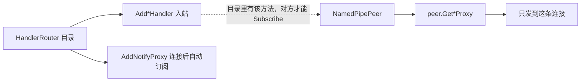
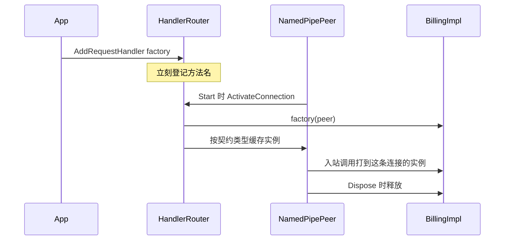
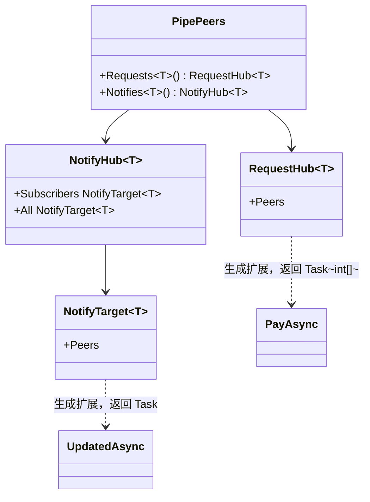

# 目录在路由器，调用在连接

`HandlerRouter` 保存本进程的方法目录：入站实现，以及连接后要自动订阅的通知名。这些内容对服务器上的每一条连接都相同。

出站代理挂在 `NamedPipePeer` 上，只发到这一条连接，并随连接释放。



| 类型 | 方法 | 作用 |
|------|------|------|
| `HandlerRouter` | `AddRequestHandler<T>(Func<NamedPipePeer, T> factory)` | 登记请求目录。每条连接在 `Start` 时用工厂创建一个 `T` |
| `HandlerRouter` | `AddNotifyHandler<T>(Func<NamedPipePeer, T> factory)` | 登记可接收的通知。每条连接一个实例，不因此自动订阅 |
| `HandlerRouter` | `AddNotifyProxy<T>()` | 连接后自动订阅该通知契约 |
| `NamedPipePeer` | `GetRequestProxy<T>()` | 缓存并返回指向这条连接的请求代理 |
| `NamedPipePeer` | `GetNotifyProxy<T>()` | 缓存并返回指向这条连接的通知代理 |

一组连接上的发送放在 `PipePeers`，每次调用读取当前快照。

## 一个连接一个处理器实例

方法目录仍在 `HandlerRouter` 上登记一次，对方看到的方法名不随连接变化。实例由工厂在每条连接 `Start` 时创建，存在该 `NamedPipePeer` 上。连接释放时，若实例实现 `IDisposable`，一并释放。



| 类型 | 方法 | 作用 |
|------|------|------|
| `HandlerRouter` | `ActivateConnection(NamedPipePeer peer)` | `Start` 开头调用。为已登记的工厂各创建一个实例，存到这条连接上 |
| `NamedPipePeer` | `GetConnectionHandler<T>()` | 取出这条连接上的 `T`。入站包装用它调用业务方法 |
| `NamedPipePeer` | `Dispose` | 释放本连接上实现了 `IDisposable` 的处理器 |

契约方法本身不加 `NamedPipePeer` 参数。需要回写这条连接时，工厂把 `peer` 存进实例字段。按方法名注册的委托保持原样，仍通过 `RpcContext<T>.Peer` 区分连接。

同一条连接上的并发调用仍会进入同一个实例，上限是该连接的 `MaxConcurrent`。

```csharp
serverRouter.AddRequestHandler<IBilling>(peer => new BillingImpl(peer));
serverRouter.AddNotifyHandler<IOrderEvents>(peer => new OrderEventsImpl(peer));
```

## 广播在 PipePeers

这一节尚未实现。当前代码只做到目录在路由器、代理在 `NamedPipePeer`。

C# 没有泛型属性，调用写成 `peers.Requests<T>().方法`。`Requests<T>()` 返回一个没有业务方法的值类型 `RequestHub<T>`。生成器按每个 `[RpcRequest]` 接口，给 `RequestHub<该接口>` 添加同名扩展方法。`Task<TResponse>` 在这里变成 `Task<TResponse[]>`，无响应的 `Task` 仍是 `Task`。

`RequestHub<T>` 不能改成实现 `T`。一个泛型方法的返回类型是固定的，而各接口的方法不同；即便返回 `T`，`PayAsync` 的返回值也仍是 `Task<int>`，装不下每条连接的结果。



| 类型 | 方法 | 作用 |
|------|------|------|
| `PipePeers` | `Requests<T>()` | 返回 `RequestHub<T>`，只保存这组连接 |
| `RequestHub<IBilling>` | `PayAsync(...)` | 生成的扩展。内部调用 `PipePeers.Request`，返回 `Task<int[]>` |
| `PipePeers` | `Notifies<T>()` | 返回 `NotifyHub<T>` |
| `NotifyHub<T>` | `Subscribers` | `NotifyTarget<T>`，扩展方法走 `NotifySubscribers` |
| `NotifyHub<T>` | `All` | `NotifyTarget<T>`，扩展方法走全量 `Notify` |

扩展方法写在契约所在程序集里，和单连接代理一起生成。`RequestHub<IBilling>` 与 `RequestHub<IInventory>` 是不同类型，同名方法不会撞在一起。

Hub 只保存 `PipePeers`，可以在还没有连接时取出，每次调用再读快照。没有连接时请求返回空数组，通知立即完成。定向通知要有接收者，发送端先 `AddNotifyHandler<T>`，接收端再 `AddNotifyProxy<T>`。

```csharp
int[] results = await service.Peers.Requests<IBilling>().PayAsync(req);

await service.Peers.Notifies<IOrderEvents>().Subscribers.UpdatedAsync("hello");
await service.Peers.Notifies<IOrderEvents>().All.UpdatedAsync("hello");
```

## 用法

```csharp
serverRouter.AddRequestHandler<IBilling>(peer => new BillingImpl(peer));
serverRouter.AddNotifyHandler<IOrderEvents>(peer => new OrderEventsImpl(peer));
clientRouter.AddNotifyProxy<IOrderEvents>();
IBilling callback = serverPeer.GetRequestProxy<IBilling>();
IOrderEvents outgoing = serverPeer.GetNotifyProxy<IOrderEvents>();

var peer = await client.ConnectAsync();
IBilling billing = peer.GetRequestProxy<IBilling>();
```

客户端只有 `ConnectAsync` 返回的那一条连接，代理从该 `NamedPipePeer` 取。服务端在接受连接得到的 `NamedPipePeer` 上取单连接代理；要同时发给多条连接时，用 `service.Peers.Requests<T>()` 或 `service.Peers.Notifies<T>()`。
