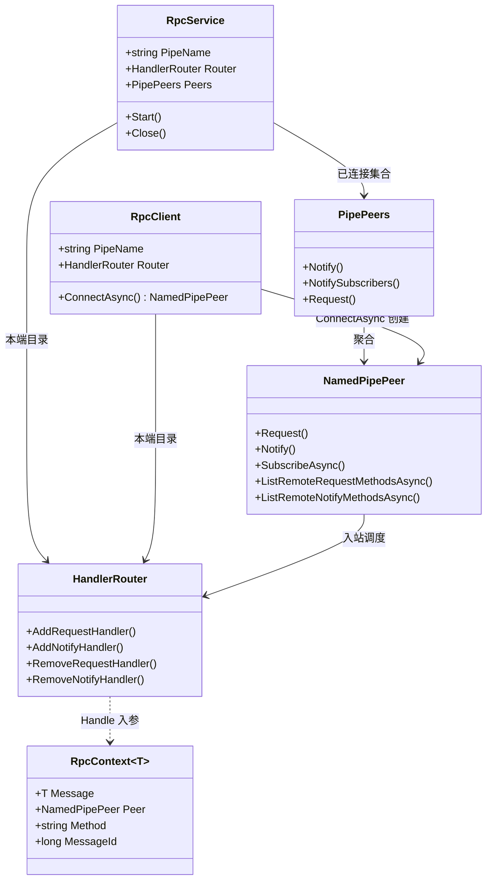
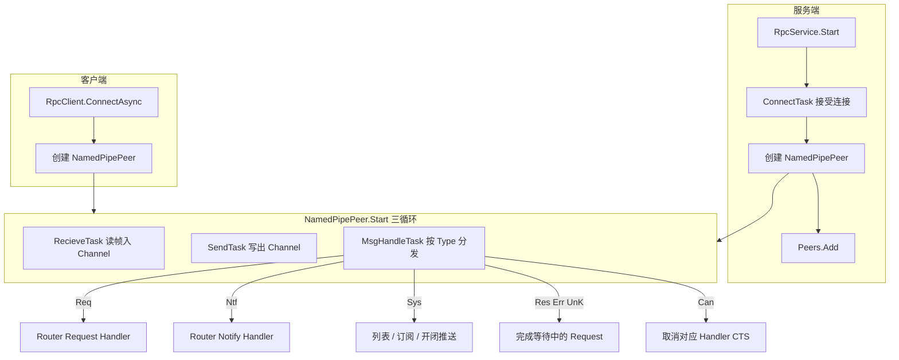
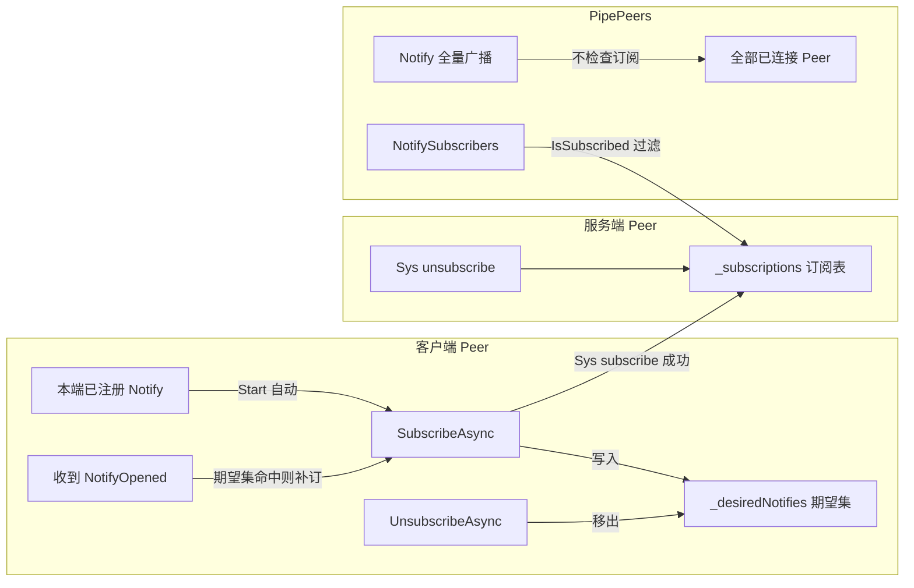

# NamedPipeRpc 结构关系

本文档用图说明库内核心类型关系与运行时数据流。使用说明见 [README.md](README.md)。

## 类关系

要点：

- 服务端：`RpcService` 接受连接后创建 `NamedPipePeer` 并加入 `Peers`。
- 客户端：`RpcClient.ConnectAsync` 返回已 `Start` 的 `NamedPipePeer`。
- 两端各自持有独立 `HandlerRouter`；对端目录不靠共享 Router，而靠 Sys。

## 连接与消息流

帧顺序：`MsgHeader(16)` → Method(UTF-8) → Payload。写出时先预留 Header，写完 Method/Payload 再回填。

## 订阅与定向推送

推荐路径：连接前 `AddNotifyHandler`（登记本端接收 + 期望订阅清单）→ `ConnectAsync` / `Start` 自动 `SubscribeAsync`。勿把「事后手动 Subscribe」当作默认用法（仅用于连接后动态增订）。

行为摘要：

| 操作 | 客户端期望集 | 服务端订阅表 |
|------|--------------|--------------|
| `SubscribeAsync` 成功 | 保留 | 加入 |
| `SubscribeAsync` 对端无方法 | 仍保留（便于补订） | 不变 |
| `UnsubscribeAsync` | 移除（不再自动补订） | 移除 |
| 对端 `NotifyClosed` | 保留 | 清除该方法 |
| 对端 `NotifyOpened` 且期望集命中 | 保留 | 自动再 Subscribe 后加入 |

`Peers.Notify` 发给快照中每一个 Peer；`Peers.NotifySubscribers` 仅发给 `IsSubscribed(method)` 为真的连接。
