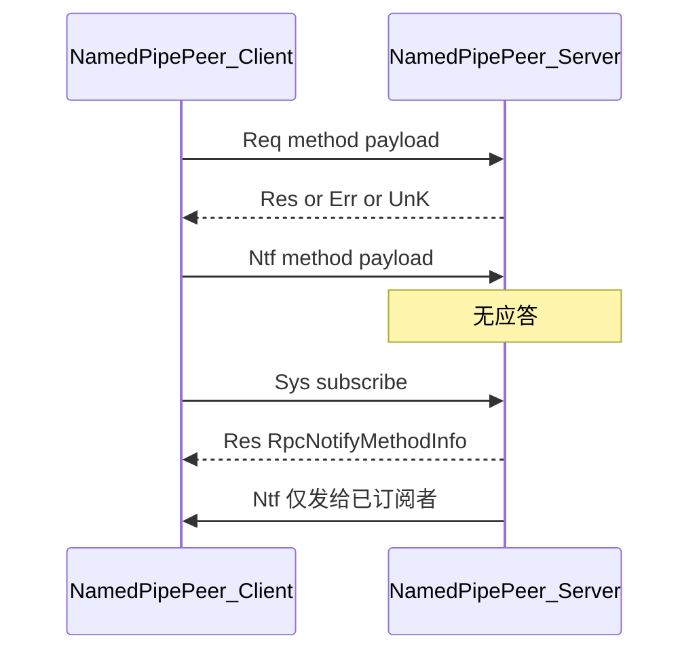

# NamedPipeRpc

基于 Windows 命名管道的双向 RPC 库（命名空间 `Xanvil.NamedPipeRpc`），面向同机进程间 IPC。目标框架：`net472` / `net8.0`。载荷序列化使用 `System.Text.Json`（`IncludeFields`、属性名大小写不敏感）。

架构关系图见 [NamedPipeRpc.struct.md](NamedPipeRpc.struct.md)。

## 心智模型

1. **Peer 是中心**：`RpcService` / `RpcClient` 只负责建连；业务收发在 `NamedPipePeer`（单连接）与 `PipePeers`（多连接广播）。
2. **Router 是本端目录**：`HandlerRouter` 只登记本端可处理的方法；对端目录通过 Sys 查询 / 推送获知。生产中两端应各自持有独立 Router，不要共享实例。
3. **无 Attribute / 无程序集扫描**：只能通过 `AddRequestHandler` / `AddNotifyHandler`（接口或委托）显式注册。
4. **客户端订阅 Notify 须预注册**：若要接收对端名为 `order.updated`（等）的通知，须在 `ConnectAsync` **之前**对本端 Router 调用 `AddNotifyHandler` 注册同名方法；连接成功、`Peer.Start` 后会自动对这些已注册方法发起 `SubscribeAsync`。

消息语义：

| 类型 | 语义 |
|------|------|
| **Request** | 有应答；支持超时与取消 |
| **Notify** | 单向无应答；可配合订阅做定向推送 |
| **Sys** | 服务发现、订阅、目录开闭推送 |

## 快速上手

```csharp
using Xanvil.NamedPipeRpc;

var pipe = "demo-pipe";

// 服务端
var serverRouter = new HandlerRouter();
serverRouter.AddRequestHandler<int, int>("billing.pay", (ctx, ct) =>
    Task.FromResult(ctx.Message + 1));

using var service = new RpcService(pipe, serverRouter);
service.Start(); // 幂等；仅首次生效

// 客户端（独立 Router）
using var client = new RpcClient(pipe);
var peer = await client.ConnectAsync();

try
{
    int result = await peer.Request<int, int>("billing.pay", 41); // 42
}
finally
{
    peer.Close();
    service.Close();
}
```

也可用接口类注册 Handler：

```csharp
public class PayHandler : IRequestHandler<int, int>
{
    public string MethodName => "billing.pay";
    public Task<int> Handle(RpcContext<int> context, CancellationToken ct)
        => Task.FromResult(context.Message + 1);
}

router.AddRequestHandler(new PayHandler());
```

## 核心类型

| 类型 | 职责 | 关键对外 API |
|------|------|-------------|
| `HandlerRouter` | 本端方法路由注册 | `AddRequestHandler` / `AddNotifyHandler` / `RemoveRequestHandler` / `RemoveNotifyHandler` |
| `RpcService` | 服务端监听、接受连接 | `Start` / `Close` / `Peers` / `Connected` / `OnError` |
| `RpcClient` | 客户端连管道 | `ConnectAsync` → `NamedPipePeer` |
| `NamedPipePeer` | 单连接收发 | `Request` / `Notify` / `SubscribeAsync` / `ListRemote*` / 远端目录事件 |
| `PipePeers` | 多连接集合与广播 | `Notify`（全量）/ `NotifySubscribers`（定向）/ `Request`（收集全部响应） |
| `RpcContext<T>` | Handler 上下文 | `Message` / `Peer` / `Method` / `MessageId`（取消令牌由 `Handle` 独立参数传入） |
| `IRequestHandler*` / `INotifyHandler*` | 强类型 Handler 契约 | `MethodName` + `Handle` |
| `Unit` | 空载荷占位 | `Unit.Value` / `Unit.Task` |

### 选项

`RpcServiceOption` / `RpcClientOption`（默认值相同处一并列出）：

| 属性 | 默认 | 说明 |
|------|------|------|
| `Version` | `1` | 协议版本；两端必须一致 |
| `MaxConcurrent` | `64` | 单 Peer 同时处理入站消息的上限 |
| `SendBuffer` / `ReceiveBuffer` | `64` | 发送 / 接收 Channel 有界容量 |
| `RequestTimeout` | `30000` ms | 等待应答超时 |
| `MaxConnect` | `-1` | 仅服务端：管道最大实例数；`<1` 表示系统允许的最大值 |

## Request / Notify / 订阅推送



### Request

```csharp
// 无载荷
await peer.Request("ping");

// 有请求、无关心响应类型时可用 Unit
await peer.Request<MyReq>("do.work", req);

// 强类型往返
var res = await peer.Request<MyReq, MyRes>("do.work", req);
```

- 超时或调用方取消时，本端发送 `Can`，对端取消对应 Handler。
- 对端无此方法：收到 `UnK` → 引发 `RequestNotFound`，并抛出 `KeyNotFoundException`。

### 客户端预注册与自动订阅（推荐）

客户端要订阅对端某个 Notify，正确做法是：**连接前**在本端 Router 注册同名 Handler（既是接收处理函数，也是「期望订阅」清单）。`ConnectAsync` 创建 Peer 并 `Start` 后，会自动对本端已注册的全部 Notify 调用 `SubscribeAsync`。

```csharp
var pipe = "demo-notify";

// 服务端：暴露 Notify（供客户端订阅）
var serverRouter = new HandlerRouter();
serverRouter.AddNotifyHandler<string>("order.updated", _ => { });

using var service = new RpcService(pipe, serverRouter);
service.Start();

// 客户端：连接前注册 —— 不要等到 Connect 之后才 AddNotifyHandler
var clientRouter = new HandlerRouter();
clientRouter.AddNotifyHandler<string>("order.updated", msg =>
{
    Console.WriteLine(msg); // 收到对端推送时执行
});

using var client = new RpcClient(pipe, clientRouter);
var peer = await client.ConnectAsync(); // Start 后自动 SubscribeAsync("order.updated")

// 此后服务端定向推送可到达该客户端
await service.Peers.NotifySubscribers("order.updated", "hello");
```

仅当连接**之后**才新增本端 Notify Handler 时，需手动补订：

```csharp
clientRouter.AddNotifyHandler<string>("order.shipped", _ => { });
await peer.SubscribeLocalNotifyHandlersAsync(); // 或单条 SubscribeAsync("order.shipped")
```

### 主动发送 Notify

单连接上发送单向通知（不检查对端是否已订阅）：

```csharp
await peer.Notify("order.updated", "hello");
```

### 多连接：全量广播 vs 定向推送

```csharp
// 发给所有已连接 peer（不检查订阅）
await service.Peers.Notify("order.updated", "to-all");

// 仅发给已 Subscribe 该方法的 peer
await service.Peers.NotifySubscribers("order.updated", "to-subscribers");
```

也可对全部 peer 发起 Request，并按快照顺序收集响应：

```csharp
int[] results = await service.Peers.Request<int, int>("billing.pay", 1);
```

## 服务发现与目录开闭

「Discovery」指运行时 **Sys 命令**，不是反射扫描。

### 查询对端目录

```csharp
RpcRequestMethodInfo[] requests = await peer.ListRemoteRequestMethodsAsync();
RpcNotifyMethodInfo[] notifies = await peer.ListRemoteNotifyMethodsAsync();
```

### 单条订阅

```csharp
// 成功：返回元数据；对端尚无该方法：返回 null，并引发 NotifyNotFound
// （方法名仍保留在客户端期望集，便于稍后自动补订）
RpcNotifyMethodInfo? info = await peer.SubscribeAsync("order.updated");

await peer.UnsubscribeAsync("order.updated"); // 移出期望集，之后不再自动补订
```

### 远端目录事件

| 事件 | 时机 |
|------|------|
| `RequestOpened` / `RequestClosed` | 对端首次注册 / 移除 Request 方法 |
| `NotifyOpened` / `NotifyClosed` | 对端首次注册 / 移除 Notify 方法 |
| `NotifyNotFound` | `SubscribeAsync` 时对端无该方法 |
| `RequestNotFound` | 普通 Request 收到 `UnK` |

服务端侧：`HandlerRouter` **首次** `Add*`（同名覆盖不推）/ `Remove*` 成功时，`RpcService` 向当前已连接 Peers 推送对应 Sys 开闭。

`NotifyOpened` 且方法仍在客户端期望集中时：先自动 `SubscribeAsync`，再引发事件。`NotifyClosed` **不**移出期望集，以便方法再次 Opened 时自动补订。

## 协议概要

帧布局（字节模式、小端）：

```
[MsgHeader 16 bytes][Method UTF-8 ≤ 255][Payload]
```

| Header 字段 | 说明 |
|-------------|------|
| `Id` | 关联请求与应答 / 取消 |
| `PayloadLength` / `MethodLength` | 后续段长度 |
| `V` | 协议版本（不匹配则断开） |
| `Type` | 见下表 |

| `MessageType` | 含义 |
|---------------|------|
| `Req` / `Res` | 请求 / 成功应答 |
| `Ntf` | 单向通知 |
| `Sys` | 系统命令（列表、订阅、开闭推送） |
| `Err` | 处理异常（UTF-8 字符串载荷） |
| `UnK` | 未知方法 |
| `Can` | 取消进行中的 Handler |

- 业务载荷：JSON；`Unit` 不写载荷。
- `Err` / `UnK`：UTF-8 字符串，非 JSON 对象。


## 测试与基准

| 工程 | 内容 |
|------|------|
| [`NamedPipeRpc.Test`](../NamedPipeRpc.Test) | 功能测试；发现 / 订阅 / 定向推送见 `ServiceDiscoveryTests` |
| [`NamedPipeRpc.Benchmark`](../NamedPipeRpc.Benchmark) | `IpcLatencyBenchmarks` / `IpcPayloadBenchmarks` / `IpcThroughputBenchmarks` / `ServiceDiscoveryBenchmarks` |

### 性能结果（.NET 8）

环境：BenchmarkDotNet v0.15.8，Windows 11，Intel Core i5-12400F，**.NET 8.0.32**。  
场景：单命名管道、单连接（吞吐并发用例除外）；Handler 无人为 `Delay`。数值随硬件变化，仅供参考。

复现：

```bash
dotnet run -c Release -f net8.0 --project NamedPipeRpc.Benchmark
```

#### 延迟（`IpcLatencyBenchmarks`）

| Method | Mean | Allocated | 说明 |
|--------|-----:|----------:|------|
| `EmptyNotify` | 26.15 μs | 1.27 KB | 单向 Notify（无应答） |
| `EmptyRequest` | 40.78 μs | 2.56 KB | 空载荷 Request 往返（基线） |
| `ComplexJsonRequest` | 69.92 μs | 4.71 KB | 嵌套对象 JSON 往返（无业务等待） |

#### 载荷梯度（`IpcPayloadBenchmarks`，`byte[]` Echo）

| PayloadBytes | Mean | Allocated |
|-------------:|-----:|----------:|
| 0 | 60.13 μs | 2.99 KB |
| 1,024 | 63.14 μs | 5.04 KB |
| 16,384 | 83.16 μs | 35.11 KB |
| 65,536 | 132.70 μs | 131.48 KB |

> 0 字节 Echo 仍走 `byte[]` JSON，故慢于 `Unit` 空 Request。

#### 吞吐（`IpcThroughputBenchmarks`）

| Method | 批量 | Mean（整批） | 换算吞吐 | Allocated（整批） |
|--------|-----:|-------------:|---------:|------------------:|
| `SerialEmptyRequests` | 1,000 串行 | 34.00 ms | **≈ 29.4k ops/s** | 2500 KB |
| `ConcurrentEmptyRequests` | 64 并发 | 1.261 ms | **≈ 50.8k ops/s** | 161 KB |

吞吐 = 批量次数 / Mean。并发对齐默认 `MaxConcurrent = 64`。

#### 服务发现与推送（`ServiceDiscoveryBenchmarks`，单连接已订阅）

| Method | Mean | Allocated |
|--------|-----:|----------:|
| `NotifySubscribers` 定向 | 25.46 μs | 1.42 KB |
| `Notify` 全量广播 | 25.65 μs | 1.42 KB |
| `ListRemoteNotifyMethods` | 52.81 μs | 3.5 KB |
| `ListRemoteRequestMethods` | 53.49 μs | 3.55 KB |
| `SubscribeAsync`（方法已存在） | 62.62 μs | 3.08 KB |

原始报告（本地运行后生成）：`BenchmarkDotNet.Artifacts/results/*-report-github.md`。
