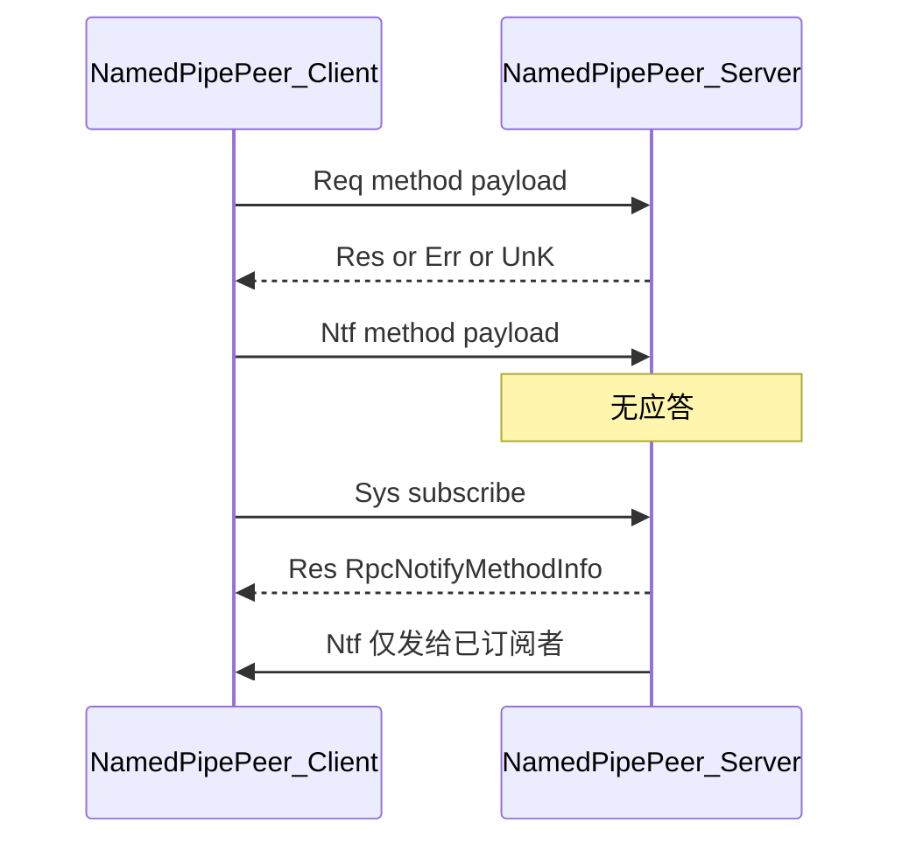

# NamedPipeRpc

基于 Windows 命名管道的双向 RPC 库（命名空间 `Xanvil.NamedPipeRpc`），面向同机进程间 IPC。目标框架：`net472` / `net8.0`。载荷序列化使用 `System.Text.Json`（`IncludeFields`、属性名大小写不敏感）。

架构关系图见 [NamedPipeRpc.struct.md](NamedPipeRpc.struct.md)；契约 Handler / Proxy 见 [NamedPipeRpc.Notify.struct.md](NamedPipeRpc.Notify.struct.md)。

## 心智模型

1. **Peer 是中心**：`RpcService` / `RpcClient` 只负责建连；业务收发在 `NamedPipePeer`（单连接）与 `PipePeers`（多连接广播）。
2. **Router 是本端目录**：`HandlerRouter` 只登记本端可处理的方法；对端目录通过 Sys 查询 / 推送获知。生产中两端应各自持有独立 Router，不要共享实例。
3. **无程序集扫描**：底层仍用按方法名的 `AddRequestHandler` / `AddNotifyHandler`。契约由 Source Generator 生成 `Add*Handler`、`AddNotifyProxy` 和连接上的 `Get*Proxy`，须显式调用。
4. **契约通知的自动订阅要单独登记**：按方法名的 `AddNotifyHandler` 仍会在连接后自动订阅。契约上的 `AddNotifyHandler<T>(factory)` 只表示本端可以接收，并且每条连接创建一个实例；要在连接后自动订阅，还要调用 `AddNotifyProxy<T>()`。

消息语义：

| 类型 | 语义 |
|------|------|
| **Request** | 有应答；支持超时与取消 |
| **Notify** | 单向无应答；可配合订阅做定向推送 |
| **Sys** | 服务发现、订阅、目录开闭推送 |

## 快速上手

```csharp
using Xanvil.NamedPipeRpc;

var pipe = "demo-pipe";

// 服务端
var serverRouter = new HandlerRouter();
serverRouter.AddRequestHandler<int, int>("billing.pay", (ctx, ct) =>
    Task.FromResult(ctx.Message + 1));

using var service = new RpcService(pipe, serverRouter);
service.Start(); // 幂等；仅首次生效

// 客户端（独立 Router）
using var client = new RpcClient(pipe);
var peer = await client.ConnectAsync();

try
{
    int result = await peer.Request<int, int>("billing.pay", 41); // 42
}
finally
{
    peer.Close();
    service.Close();
}
```

也可用接口类注册 Handler：

```csharp
public class PayHandler : IRequestHandler<int, int>
{
    public string MethodName => "billing.pay";
    public Task<int> Handle(RpcContext<int> context, CancellationToken ct)
        => Task.FromResult(context.Message + 1);
}

router.AddRequestHandler(new PayHandler());
```

## 接口契约（Source Generator）

`[RpcRequest]` 表示请求服务，`[RpcNotify]` 表示通知通道。同一个接口可以同时出现在服务端和客户端，接口本身不表示角色：

| 调用 | 角色 |
|------|------|
| `router.AddRequestHandler<T>(factory)` | 登记请求目录。每条连接 `Start` 时创建一个实例 |
| `router.AddNotifyHandler<T>(factory)` | 本端可以接收的通知。每条连接一个实例，不因此自动订阅 |
| `router.AddNotifyProxy<T>()` | 连接建立后自动订阅该通知契约 |
| `peer.Get*Proxy<T>()` | 返回源生成器生成的代理，只发到这一条连接。静态类型是契约接口 |

`Get*Proxy` 返回的对象实现 `T`，但是生成的代理，不能再传给 `Add*Handler`。关系图见 [NamedPipeRpc.Notify.struct.md](NamedPipeRpc.Notify.struct.md)。按方法名的 `AddRequestHandler(string, ...)` / `AddNotifyHandler(string, ...)` 仍然可用，不经过生成器。

### 特性

| 特性 | 标在 | 作用 |
|------|------|------|
| `[RpcRequest]` / `[RpcRequest("前缀")]` | 接口或服务类 | 请求服务。`""` 表示默认无前缀；省略则用类型短名 |
| `[RpcNotify]` / `[RpcNotify("前缀")]` | 仅接口 | 通知通道。方法必须全部返回非泛型 `Task` |
| `[RpcMethod("整段名")]` | 方法 | 覆盖完整 RPC 名 |
| `[RpcMethod(Prefix = "…")]` | 方法 | 只覆盖本方法前缀，含 `Prefix = ""` |

一个类型不能同时标 `[RpcRequest]` 和 `[RpcNotify]`。

### 跨程序集匹配（不要求共享接口 DLL）

管道上不要求两端引用同一契约程序集，也不要求 CLR 类型同一。互通只认：

1. **RPC 方法名**字符串一致（OrdinalIgnoreCase）
2. **载荷 / 响应 JSON 形状**兼容（属性或字段名对应；两端可以是不同的 `PayReq` 类型）

每端各自定义接口、各自跑生成器。默认名是 `{前缀}.{短名}`：短名是 CLR 方法名去掉尾缀 `Async`；前缀是特性构造参数，未写则用类型短名。

```csharp
[RpcRequest]
public interface IBilling
{
    Task<int> PayAsync(PayReq req, CancellationToken ct = default); // IBilling.Pay

    [RpcMethod("billing.refund")]
    Task RefundAsync(RefundReq req, CancellationToken ct = default);
}

[RpcNotify]
public interface IOrderEvents
{
    Task UpdatedAsync(string msg, CancellationToken ct = default); // IOrderEvents.Updated
}
```

业务参数个数决定载荷，两种形状不要混用。`CancellationToken` 不进载荷。没有业务参数时不写载荷。

| 业务参数 | 载荷 | 名称 |
|---|---|---|
| 1 个 | 就是这个参数的 JSON。`PayAsync(PayReq req)` 的载荷是 `PayReq` 本身 | 不要求两端参数名一致 |
| 2 个及以上 | 生成参数包。`DescribeAsync(int id, string tag)` 的载荷是 `{ "id": 1, "tag": "x" }` | 字段名必须一致。缺少的字段使用该类型的默认值（`0`、`null`、`false`），不是方法上的 `= 默认值` |

可以省略的成员不要拆成多个方法参数。放进一个自定义类型，作为那一个参数发出去。类型内部的缺字段由 JSON 反序列化决定：

```csharp
public sealed class QuoteReq
{
    public int Amount { get; set; }
    public string? Currency { get; set; } // 缺字段则为 null
    public int? Retries { get; set; }
}

Task<string> QuoteAsync(QuoteReq req, CancellationToken ct = default);
// 载荷是 QuoteReq，不是 { "req": ... }。另一端参数可以不叫 req
```

### 请求：注册实现与调用对方

```csharp
// 服务端登记工厂。T 可以是接口，也可以是实现了该接口的类
serverRouter.AddRequestHandler<IBilling>(peer => new BillingImpl(peer));

// 客户端从自己的那条连接取出代理
var peer = await client.ConnectAsync();
IBilling billing = peer.GetRequestProxy<IBilling>();
int n = await billing.PayAsync(new PayReq { Amount = 41 });
```

`[RpcRequest]` 也可以标在服务类上，只用 `AddRequestHandler`。客户端用接口加相同前缀（或相同的 `[RpcMethod]`）对齐：

```csharp
[RpcRequest] // 默认前缀 InventoryService
public class InventoryService
{
    public Task<int> GetStockAsync(string sku, CancellationToken ct = default) => /* ... */;
}
serverRouter.AddRequestHandler(peer => new InventoryService()); // InventoryService.GetStock

[RpcRequest("InventoryService")]
public interface IInventory
{
    Task<int> GetStockAsync(string sku, CancellationToken ct = default);
}
```

服务端一个路由器对应全部连接。要调用其中某一条连接，从那个 `NamedPipePeer` 取代理：

```csharp
IBilling one = serverPeer.GetRequestProxy<IBilling>();
```

### 通知：接收与发送

`AddNotifyHandler<T>(factory)` 让本端可以接收，并出现在目录里，这样对方的订阅才能成功。它不会自动订阅。每条连接 `Start` 时调用工厂创建一个实例；实例实现 `IDisposable` 时，连接释放会调用 `Dispose`。接收端再调用 `AddNotifyProxy<T>()`，连接后才会自动订阅。发送使用 `GetNotifyProxy` 返回的生成代理。

```csharp
// 服务端：可以接收该通知，但不自动订阅
serverRouter.AddNotifyHandler<IOrderEvents>(peer => new OrderEventsImpl(peer));

// 客户端：可以接收，并在连接后自动订阅
clientRouter.AddNotifyHandler<IOrderEvents>(peer => new OrderEventsSink(peer));
clientRouter.AddNotifyProxy<IOrderEvents>();

// 生成的代理只向这一条连接发送
IOrderEvents outgoing = serverPeer.GetNotifyProxy<IOrderEvents>();
await outgoing.UpdatedAsync("hello");
```

多连接上的全量广播和按订阅定向推送仍用 `PipePeers` 的字符串 API：`Notify` 与 `NotifySubscribers`。

### 诊断

| ID | 条件 |
|----|------|
| NPRC001 | 方法返回类型不是 `Task` / `Task<T>` |
| NPRC002 | 契约类型带类型参数 |
| NPRC003 | RPC 名 UTF-8 超过 255 字节 |
| NPRC004 | 契约含属性、事件、索引器等非方法成员 |
| NPRC005 | 方法含 `ref` / `in` / `out` 参数 |
| NPRC006 | `[RpcNotify]` 方法返回 `Task<T>` |
| NPRC007 | 同一类型同时标了 `[RpcRequest]` 与 `[RpcNotify]` |

通过 **NuGet** 引用本库时会自动启用 Generator。同解决方案内若只用 `ProjectReference` 引用主库，需额外将 `NamedPipeRpc.Generators` 以 Analyzer 方式引用（`NamedPipeRpc.Test.ClientContracts` / `ServerContracts` 已示例）。

## 核心类型

| 类型 | 职责 | 关键对外 API |
|------|------|-------------|
| `HandlerRouter` | 本端方法目录 | 按方法名的 `AddRequestHandler` / `AddNotifyHandler`；契约的 `Add*Handler` / `AddNotifyProxy` |
| `RpcService` | 服务端监听、接受连接 | `Start` / `Close` / `Peers` / `Connected` / `OnError` |
| `RpcClient` | 客户端连管道 | `ConnectAsync` → `NamedPipePeer` |
| `NamedPipePeer` | 单连接收发 | `Request` / `Notify`；契约的 `GetRequestProxy` / `GetNotifyProxy`；`SubscribeAsync` / `ListRemote*` |
| `PipePeers` | 多连接集合与广播 | `Notify`（全量）/ `NotifySubscribers`（定向）/ `Request`（收集全部响应） |
| `RpcContext<T>` | Handler 上下文 | `Message` / `Peer` / `Method` / `MessageId`（取消令牌由 `Handle` 独立参数传入） |
| `IRequestHandler*` / `INotifyHandler*` | 强类型 Handler 契约 | `MethodName` + `Handle` |
| `RpcRequestAttribute` / `RpcNotifyAttribute` / `RpcMethodAttribute` | 契约标记 | 请求服务 / 通知通道 / RPC 名覆盖 |
| `RpcGeneratedExtensions`（生成） | 契约扩展 | `Add*Handler` / `AddNotifyProxy` / `peer.Get*Proxy` |
| `Unit` | 空载荷占位 | `Unit.Value` / `Unit.Task` |

### 选项

`RpcServiceOption` / `RpcClientOption`（默认值相同处一并列出）：

| 属性 | 默认 | 说明 |
|------|------|------|
| `Version` | `1` | 协议版本；两端必须一致 |
| `MaxConcurrent` | `64` | 单 Peer 同时处理入站消息的上限 |
| `SendBuffer` / `ReceiveBuffer` | `64` | 发送 / 接收 Channel 有界容量 |
| `RequestTimeout` | `30000` ms | 等待应答超时 |
| `MaxConnect` | `-1` | 仅服务端：管道最大实例数；`<1` 表示系统允许的最大值 |

## Request / Notify / 订阅推送



### Request

```csharp
// 无载荷
await peer.Request("ping");

// 有请求、无关心响应类型时可用 Unit
await peer.Request<MyReq>("do.work", req);

// 强类型往返
var res = await peer.Request<MyReq, MyRes>("do.work", req);
```

- 超时或调用方取消时，本端发送 `Can`，对端取消对应 Handler。
- 对端无此方法：收到 `UnK` → 引发 `RequestNotFound`，并抛出 `KeyNotFoundException`。

### 客户端预注册与自动订阅（推荐）

按方法名注册时，**连接前**在本端 Router 登记 Handler。它既是接收处理函数，也是连接后的自动订阅清单。`ConnectAsync` 创建 Peer 并 `Start` 后，会对这份清单调用 `SubscribeAsync`。

契约接口不走这条合并路径：`AddNotifyHandler<T>(factory)` 只表示本端可以接收，并为每条连接创建一个实例；`AddNotifyProxy<T>()` 才加入自动订阅清单。发送用 `peer.GetNotifyProxy<T>()`，返回的是生成器产出的代理。

```csharp
var pipe = "demo-notify";

// 服务端：暴露 Notify（供客户端订阅）
var serverRouter = new HandlerRouter();
serverRouter.AddNotifyHandler<string>("order.updated", _ => { });

using var service = new RpcService(pipe, serverRouter);
service.Start();

// 客户端：连接前注册 —— 不要等到 Connect 之后才 AddNotifyHandler
var clientRouter = new HandlerRouter();
clientRouter.AddNotifyHandler<string>("order.updated", msg =>
{
    Console.WriteLine(msg); // 收到对端推送时执行
});

using var client = new RpcClient(pipe, clientRouter);
var peer = await client.ConnectAsync(); // Start 后自动 SubscribeAsync("order.updated")

// 此后服务端定向推送可到达该客户端
await service.Peers.NotifySubscribers("order.updated", "hello");
```

仅当连接**之后**才新增本端 Notify Handler 时，需手动补订：

```csharp
clientRouter.AddNotifyHandler<string>("order.shipped", _ => { });
await peer.SubscribeLocalNotifyHandlersAsync(); // 或单条 SubscribeAsync("order.shipped")
```

### 主动发送 Notify

单连接上发送单向通知（不检查对端是否已订阅）：

```csharp
await peer.Notify("order.updated", "hello");
```

### 多连接：全量广播 vs 定向推送

```csharp
// 发给所有已连接 peer（不检查订阅）
await service.Peers.Notify("order.updated", "to-all");

// 仅发给已 Subscribe 该方法的 peer
await service.Peers.NotifySubscribers("order.updated", "to-subscribers");
```

也可对全部 peer 发起 Request，并按快照顺序收集响应：

```csharp
int[] results = await service.Peers.Request<int, int>("billing.pay", 1);
```

## 服务发现与目录开闭

「Discovery」指运行时 **Sys 命令**，不是反射扫描。

### 查询对端目录

```csharp
RpcRequestMethodInfo[] requests = await peer.ListRemoteRequestMethodsAsync();
RpcNotifyMethodInfo[] notifies = await peer.ListRemoteNotifyMethodsAsync();
```

### 单条订阅

```csharp
// 成功：返回元数据；对端尚无该方法：返回 null，并引发 NotifyNotFound
// （方法名仍保留在客户端期望集，便于稍后自动补订）
RpcNotifyMethodInfo? info = await peer.SubscribeAsync("order.updated");

await peer.UnsubscribeAsync("order.updated"); // 移出期望集，之后不再自动补订
```

### 远端目录事件

| 事件 | 时机 |
|------|------|
| `RequestOpened` / `RequestClosed` | 对端首次注册 / 移除 Request 方法 |
| `NotifyOpened` / `NotifyClosed` | 对端首次注册 / 移除 Notify 方法 |
| `NotifyNotFound` | `SubscribeAsync` 时对端无该方法 |
| `RequestNotFound` | 普通 Request 收到 `UnK` |

服务端侧：`HandlerRouter` **首次** `Add*`（同名覆盖不推）/ `Remove*` 成功时，`RpcService` 向当前已连接 Peers 推送对应 Sys 开闭。

`NotifyOpened` 且方法仍在客户端期望集中时：先自动 `SubscribeAsync`，再引发事件。`NotifyClosed` **不**移出期望集，以便方法再次 Opened 时自动补订。

## 协议概要

帧布局（字节模式、小端）：

```
[MsgHeader 16 bytes][Method UTF-8 ≤ 255][Payload]
```

| Header 字段 | 说明 |
|-------------|------|
| `Id` | 关联请求与应答 / 取消 |
| `PayloadLength` / `MethodLength` | 后续段长度 |
| `V` | 协议版本（不匹配则断开） |
| `Type` | 见下表 |

| `MessageType` | 含义 |
|---------------|------|
| `Req` / `Res` | 请求 / 成功应答 |
| `Ntf` | 单向通知 |
| `Sys` | 系统命令（列表、订阅、开闭推送） |
| `Err` | 处理异常（UTF-8 字符串载荷） |
| `UnK` | 未知方法 |
| `Can` | 取消进行中的 Handler |

- 业务载荷：JSON；`Unit` 不写载荷。
- `Err` / `UnK`：UTF-8 字符串，非 JSON 对象。


## 测试与基准

| 工程 | 内容 |
|------|------|
| [`NamedPipeRpc.Test`](../NamedPipeRpc.Test) | 功能测试；发现 / 订阅见 `ServiceDiscoveryTests`；契约代理见 `RpcContractProxyTests` |
| [`NamedPipeRpc.Test.ClientContracts`](../NamedPipeRpc.Test.ClientContracts) / [`ServerContracts`](../NamedPipeRpc.Test.ServerContracts) | 跨程序集契约端到端：同名接口、类注册、`[RpcMethod]`、类契约名对齐 |
| [`NamedPipeRpc.Benchmark`](../NamedPipeRpc.Benchmark) | `IpcLatencyBenchmarks` / `IpcPayloadBenchmarks` / `IpcThroughputBenchmarks` / `ServiceDiscoveryBenchmarks` |

### 性能结果（.NET 8）

环境：BenchmarkDotNet v0.15.8，Windows 11，Intel Core i5-12400F，**.NET 8.0.32**。  
场景：单命名管道、单连接（吞吐并发用例除外）；Handler 无人为 `Delay`。数值随硬件变化，仅供参考。

复现：

```bash
dotnet run -c Release -f net8.0 --project NamedPipeRpc.Benchmark
```

#### 延迟（`IpcLatencyBenchmarks`）

| Method | Mean | Allocated | 说明 |
|--------|-----:|----------:|------|
| `EmptyNotify` | 26.15 μs | 1.27 KB | 单向 Notify（无应答） |
| `EmptyRequest` | 40.78 μs | 2.56 KB | 空载荷 Request 往返（基线） |
| `ComplexJsonRequest` | 69.92 μs | 4.71 KB | 嵌套对象 JSON 往返（无业务等待） |

#### 载荷梯度（`IpcPayloadBenchmarks`，`byte[]` Echo）

| PayloadBytes | Mean | Allocated |
|-------------:|-----:|----------:|
| 0 | 60.13 μs | 2.99 KB |
| 1,024 | 63.14 μs | 5.04 KB |
| 16,384 | 83.16 μs | 35.11 KB |
| 65,536 | 132.70 μs | 131.48 KB |

> 0 字节 Echo 仍走 `byte[]` JSON，故慢于 `Unit` 空 Request。

#### 吞吐（`IpcThroughputBenchmarks`）

| Method | 批量 | Mean（整批） | 换算吞吐 | Allocated（整批） |
|--------|-----:|-------------:|---------:|------------------:|
| `SerialEmptyRequests` | 1,000 串行 | 34.00 ms | **≈ 29.4k ops/s** | 2500 KB |
| `ConcurrentEmptyRequests` | 64 并发 | 1.261 ms | **≈ 50.8k ops/s** | 161 KB |

吞吐 = 批量次数 / Mean。并发对齐默认 `MaxConcurrent = 64`。

#### 服务发现与推送（`ServiceDiscoveryBenchmarks`，单连接已订阅）

| Method | Mean | Allocated |
|--------|-----:|----------:|
| `NotifySubscribers` 定向 | 25.46 μs | 1.42 KB |
| `Notify` 全量广播 | 25.65 μs | 1.42 KB |
| `ListRemoteNotifyMethods` | 52.81 μs | 3.5 KB |
| `ListRemoteRequestMethods` | 53.49 μs | 3.55 KB |
| `SubscribeAsync`（方法已存在） | 62.62 μs | 3.08 KB |

原始报告（本地运行后生成）：`BenchmarkDotNet.Artifacts/results/*-report-github.md`。
